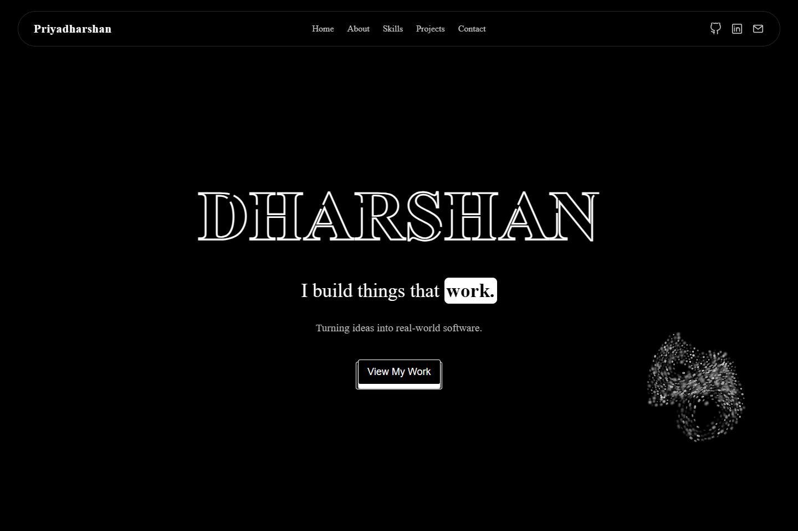

# Priyadharshan Portfolio

**I build things that work.**  
Turning ideas into real-world software.

A personal portfolio for job opportunities and freelance collaborations, showcasing my development skills, platform integration work, and approach to building complete applications.



## About

I'm M. Priyadharshan, a developer based in India. My interests span Python application development, API integrations, data migration, cloud infrastructure, and deployment automation.

The About section highlights my work on DataGrine, including helpdesk migrations for Freshdesk, Intercom, Zendesk, and Salesforce, with Outlook and Gmail migrations in progress.

## Features

- Responsive layout with a transparent floating navigation bar and mobile menu.
- Animated name and rotating professional roles.
- Interactive particle swarm that follows the cursor and responds to controls.
- Grouped skill cards with technology icons, hover colors, and revealing labels.
- The original React Bits FlexCarousel with its rise entrance, liquid-edge distortion, drag and wheel scrolling, click-to-focus interaction, and keyboard navigation.
- A Let's Connect section for meeting scheduling, followed by contact details and an email draft form in the footer.
- Keyboard navigation and reduced-motion support for custom animations.

## Built with

HTML, CSS, and JavaScript, with React and OGL for the project carousel, WebGL for the swarm animation, the Web Animations API for text transitions, and AOS for scroll animations. Technology icons include Devicon assets.

This is a static website. The compiled carousel files are committed, so no package installation or build is required to serve it. React is used only for the carousel.

## Run locally

1. Download or clone this repository.
2. Open the project folder in Visual Studio Code.
3. Start Live Server from `priyadharshan-portfolio/index.html`.
4. Open the local address shown by Live Server.

Alternatively, if Python is installed, run this command from the repository root:

```sh
python -m http.server 5500
```

Then visit [the local portfolio](http://localhost:5500/priyadharshan-portfolio/).

An internet connection is needed for AOS and the external Google Calendar booking page.

## Editing the carousel

The original component and stylesheet live in `src/carousel/`. `src/projects.jsx` supplies the local placeholder images and a fallback for browsers without WebGL. The component preserves the original manual scrolling, distortion, and click-to-focus behavior. Larger landscape previews adapt to the viewport; captions and counters are disabled so the animation displays images only. No custom drift, edge masks, or bend limits are applied.

After changing its source, rebuild the static JavaScript and CSS from the repository root:

```sh
npm ci
npm run build:carousel
```

Commit the source changes and generated files together. Netlify can continue serving the `priyadharshan-portfolio` directory with its build command left empty.

## Project structure

```text
Portfolio/
├── README.md
├── LICENSE
├── portfolio-preview.png                 # Current homepage screenshot
├── package.json              # Carousel dependencies and build command
├── package-lock.json
├── scripts/build-carousel.mjs
├── src/
│   ├── projects.jsx          # Portfolio carousel integration
│   └── carousel/             # Original React Bits component and CSS
└── priyadharshan-portfolio/
    ├── index.html             # Page content and sections
    ├── style.css              # Layout, styling, and hover effects
    ├── script.js              # Navigation and contact interactions
    ├── swarm-cursor.js        # Interactive particle animation
    ├── project-carousel.js    # Generated carousel bundle
    ├── project-carousel.css   # Generated carousel styles
    ├── LICENSE.txt            # Published license notices
    ├── rotating-role.js       # Rotating role text
    └── assets/
        ├── icon/              # Technology and platform icons
        └── images/            # Profile and project visuals
```

## Current status

The project carousel currently uses six local mockups and displays **Updating Project Soon**. These images are placeholders, not completed project screenshots. Repository and demo buttons remain disabled until real links are added. Replace the preview images and project content when ready.

The contact form opens a prefilled draft in the visitor's configured email application. It does not send messages directly; the visitor reviews and sends the draft from their email app.

The Let's Connect section uses a custom dark meeting card with a direct link to the 15-minute Google Calendar appointment schedule. Available times, booking confirmation, and Google Meet details are handled on Google Calendar.

## Contact

- **Email:** [priyadharshan.exe@gmail.com](mailto:priyadharshan.exe@gmail.com)
- **LinkedIn:** [priyadharshanexe](https://www.linkedin.com/in/priyadharshanexe/)
- **GitHub:** [priyadharshanexe](https://github.com/priyadharshanexe)
- **Location:** India
- **Book a call:** [Google Calendar appointment page](https://calendar.app.google/1E68HEknauAzNeWk8)

## License

Copyright (c) 2026 M. Priyadharshan. See [LICENSE](LICENSE) for the portfolio's usage terms and third-party component notices.


